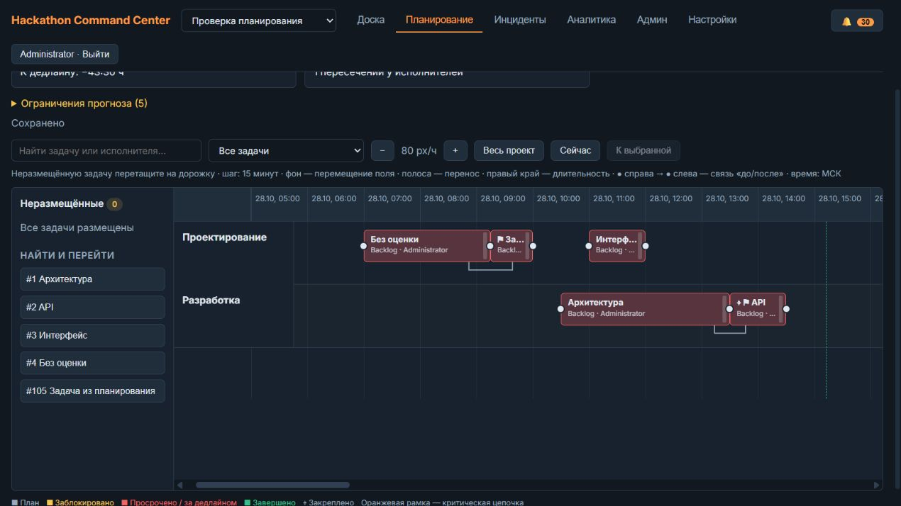

# Планирование

Вкладка «Планирование» — представление общих задач Kanban: треки, создание задач и общая карточка, размещение/перенос мышью, изменение оценки за правый край, направленные связи, прогноз, поиск, панорамирование и масштабирование. На узком окне карточка открывается под диаграммой.

## Права и хранение

Просмотр доступен всем участникам проекта. Изменение плана — только капитанам этого проекта и глобальным администраторам. Завершённый проект доступен для чтения. Общие операции Kanban сохраняют существующие права: изменение участником оценки на доске отражается в планировании.

Миграция `20261028_planning` добавляет `planning_states` (версия проекта), `planning_lanes`, `task_placements` (задача, дорожка, начало, закрепление), `planning_baselines` (снимки) и фактические отметки начала/завершения в `tasks`. Основные данные задачи не копируются. Миграция не размещает старые задачи произвольно и не меняет таймеры. Фактическое начало восстанавливается по сегментам таймеров, завершение — по сохранённым событиям перехода в завершённое состояние. При отсутствии свидетельств время остаётся неизвестным.

Корзина исключается из диаграммы и выбора связей. Положение сохраняется для восстановления. При удалённой дорожке или отсутствующей положительной оценке задача возвращается в неразмещённые. При удалении дорожки можно выбрать другую либо неразмещённые; задачи сохраняются. Очистка административной песочницы учитывает новые таблицы, предварительно архивируя данные штатным механизмом.

## Единый план и треки

Треки создаются в настройках и доступны в карточке задачи на доске. Это те же сущности, что строки Ганта. Внутренние имена API `/modules` и `module_id` сохранены для совместимости. Миграция `20261028_tracks` объединяет прежние дорожки и модули, при расхождении предпочитая модуль задачи; положения и фактические таймеры сохраняются.

Задача с треком автоматически размещается на ближайшую следующую четверть часа. Без оценки используется час. Зависимости сдвигают начало после самого позднего предшественника. Без трека задача остаётся неразмещённой. Капитан перетаскивает её на трек; правым краем изменяет оценку с шагом 15 минут, минимум 15 минут. Трек, оценка и дедлайн общие с Kanban: дедлайн равен плановому началу плюс оценка, в том числе после пересчёта зависимостей. Правка срока на доске меняет начало полосы. Таймер показывает фактически затраченное время, переносы его не сбрасывают. Начатые последователи автоматически не переносятся: нарушение зависимости требует ручной проверки.

Отдельная фиксация исходного плана и отклонения из интерфейса удалены. Исторические снимки остаются в базе для сохранности данных. Клик по пустому полю закрывает карточку.

## Автосохранение и синхронизация

Переносы сохраняются одной транзакцией вместе с пересчётом зависимостей, оценок и сроков. Смена колонки сохраняет штатные автоматические действия таймеров. Устаревшая запись получает `409 VERSION_CONFLICT`; интерфейс обновляется и показывает предупреждение, не повторяя запись за пользователя.

`GET /api/v1/projects/{project_id}/events` передаёт изменения через SSE. Сервер проверяет сохранённую версию проекта каждые 250 мс и повторно проверяет доступ; подключения не удерживают транзакции базы. Доска и Гант обновляются автоматически после сохранения. Переподключение загружает актуальную версию; при недоступном канале предусмотрен резервный опрос. Данные до фиксации транзакции другим участникам не передаются.

Прогноз учитывает размещённые задачи и зависимости. Рабочие смены, календарь доступности и вероятностный остаток работы не моделируются. «К дедлайну» показывает разницу в формате часы:минуты; плюс означает завершение после дедлайна.

## Проверка

«До/после» — мягкая рекомендация: новая связь задаёт начальное размещение, но ручное перекрытие допускается и сохраняется. «Заблокирована (blocked by)» / «блокирует» — жёсткая связь: начало не раньше окончания предшественника, запуск работы и таймера запрещён до его завершения. Меню стрелки позволяет переключить тип связи, сохраняя направление. В обеих карточках задачи доступно удаление связи с подтверждением «ОК».

Единые цвета Ганта и Kanban: серый — ожидание дальше по цепочке; голубой — нет предшественников или все завершены; синий — работа начата; зелёный — выполнена; жёлтый/оранжевый — непосредственный незавершённый предшественник уже начат (мягкая/жёсткая связь); красный — просроченная незавершённая задача. Цвет не распространяется транзитивно. Активные инциденты отмечаются треугольниками отдельно от цвета задачи; на треке учитываются его прямые инциденты и инциденты задач.

Форма инцидента фильтрует исходные задачи по исполнителю, тегу и треку. Аналитика показывает уникальные незавершённые задачи по глубинам 1–4: жёсткий каскад отдельно от потенциальных путей через мягкие связи, прирост, участников, треки и плановый интервал. Сценарии задержки 15/60/240 минут учитывают запас времени в жёстких связях, не изменяют план, таймеры и срочность. Исходная задача и выбранная глубина сохраняются в событии создания; старые инциденты рассчитываются от явно отмеченных задач с соответствующей пометкой. При отсутствии размещений прогноз частичный.

Прогноз и проверка капитаном расположены под графиком. У пересечений перечисляются обе задачи, общие исполнители и временной интервал; перекрытия мягких связей явно помечены допустимыми.

Тесты покрывают треки, общий дедлайн и оценку, автоматическое размещение, связи, таймеры, права и изоляцию, конфликты записи и SSE. Миграционная регрессия проверяет приоритет модуля при конфликте с дорожкой и сохранение времени начала. Мышью проверены растягивание с шагом 15 минут, обновление оценки и срока в общей карточке, сдвиг последователя и закрытие карточки кликом по фону.

